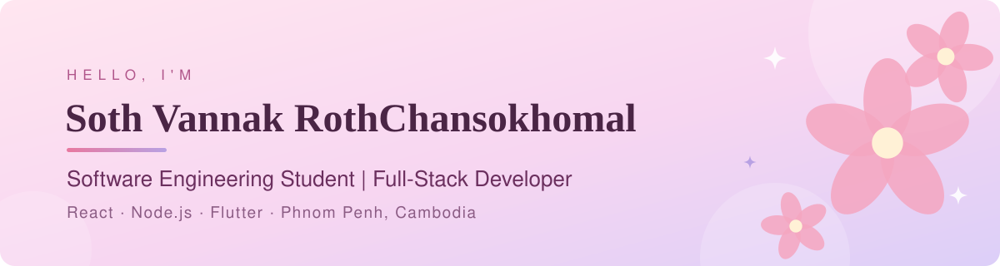
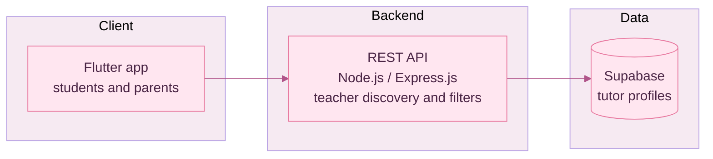
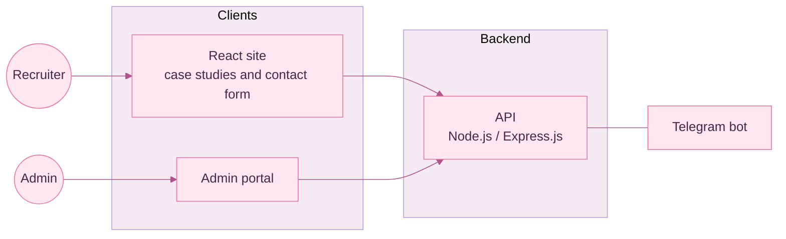
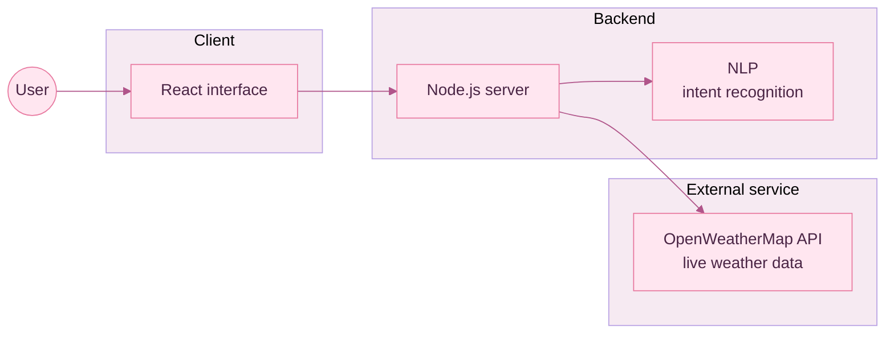
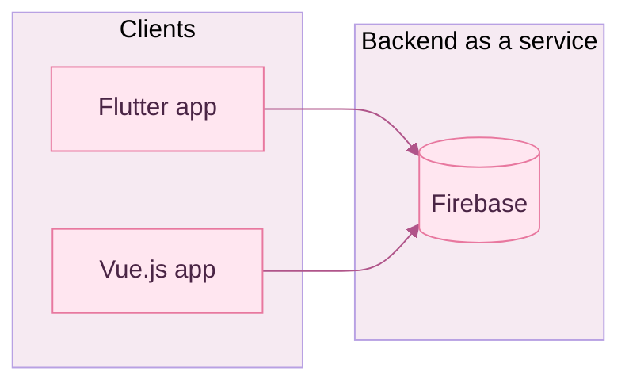
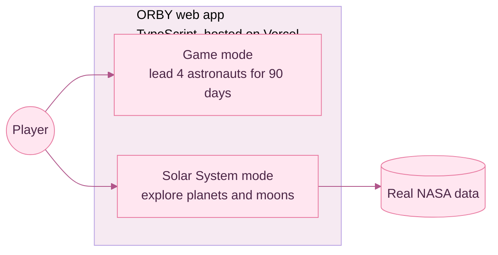
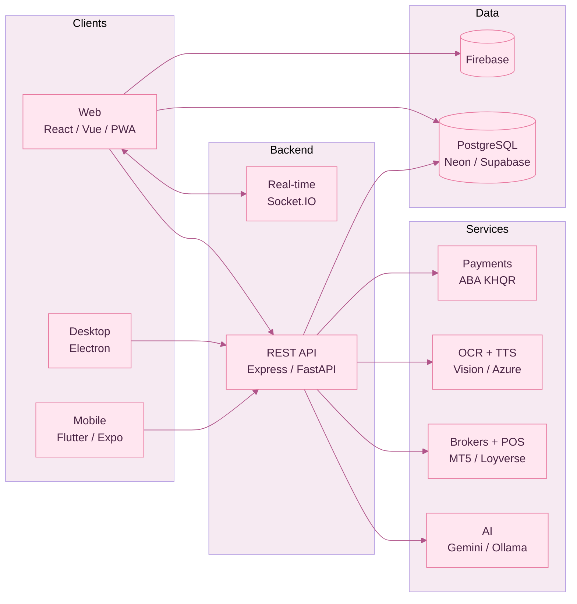

### Software engineering student building full-stack web and mobile products with React, Node.js and Flutter.

Based in Phnom Penh, Cambodia 🌸

 

<table align="center">
  <tr>
    <td align="center" width="33%">🥈 <b>First Runner-Up</b> E-Gen Innovation Program, MoEYS (2025)</td>
    <td align="center" width="33%">🏅 <b>Top 5 Finalist</b> SEA Sponge City Innovation Challenge (2025)</td>
    <td align="center" width="33%">🛰️ <b>NASA Space Apps Challenge</b> ORBY, a space-exploration game with real NASA data</td>
  </tr>
</table>

---

## ✨ About

I am a second-year Software Engineering student at CamTech. I build practical software: reliable backend services, clear interfaces, and products that work for the people who use them. I work well in teams and I care about accessibility, especially for communities with limited internet access.

| | |
|---|---|
| 💬 **Languages** | Khmer (native), English (fluent) |
| 🌱 **Looking for** | Software engineering internships (full-stack and backend) |

## 🧭 How I Work in the Era of AI

AI helps me build faster, but good software still starts with people. This is the order I follow:

1. **Know the problem from the user.** I start with the people who will use the product.
2. **Plan the project with the SDLC.** I follow the Software Development Life Cycle and write every document the user's requirements call for.
3. **Design the whole system.** I plan the system design and the architecture of the full system.
4. **Design the UX/UI.** I shape the experience and the interface before the build.

### The six stages

| # | Stage | What I do | Key deliverables |
|---|---|---|---|
| 01 | **Problem Discovery** Empathize and frame | Identify real-world friction points, user frustrations and technical constraints before writing a single line of code. | User interviews, problem definition, scope mapping |
| 02 | **Research and Insights** Explore and analyze | Analyze existing solutions, survey target audiences and form data-backed architectural hypotheses. | Competitive auditing, user personas, feature matrix |
| 03 | **UX Architecture** Structure and flow | Map user journeys and information architecture, and set up scalable database schemas and API contracts. | Wireframing, user flowcharts, API contract specs |
| 04 | **UI Design and Prototyping** Design and iterate | Craft design systems in Figma with tokens, typography hierarchy, high contrast and interactive prototypes. | Design system tokens, Figma high-fidelity mockups, interactive prototypes |
| 05 | **Agile Engineering** Develop and test | Translate designs into clean TypeScript and React code with full modularity, state management and edge-case testing. | React / Next.js implementation, Node.js API integration, unit and end-to-end validation |
| 06 | **Ship and Iterate** Deploy and optimize | Deploy to cloud platforms, evaluate Core Web Vitals and keep gathering user feedback for continuous improvement. | Production CI/CD, performance tuning, post-launch analytics |

### System architecture: shaped by the project

I do not use one fixed architecture. I start from the same layers (clients, backend, data and services) and keep only what each project needs.

<b>📚 Jomnes App</b>: mobile app with a REST API

<b>🌐 Portfolio Website with Admin Portal</b>: public site, admin area and Telegram bot

<b>🌦️ AI-Powered Weather Chatbot</b>: conversational interface with NLP and live data

<b>🏠 HomeSweet Rental App</b>: cross-platform clients on Firebase

<b>🚀 ORBY</b>: web game with real NASA data

<b>🧩 Full reference architecture</b>: every layer I can combine

---

## 🎀 Tech Stack

**Languages**

**Web and backend**

**AI and computer vision**

**Mobile**

**Databases and platforms**

**Tools and practices**

---

<h1 align="center">🌸 Featured Projects 🌸</h1>

Selected work across engineering, innovation and community impact.

 

<h2 align="center">💻 Engineering</h2>

Full-stack, mobile and computer vision work

<!-- TODO: add your role in ORBY and the Space Apps result to the ORBY card -->
<!-- TODO: say what the admin portal manages and what the Telegram bot does -->
<!-- TODO: add the Jomnes live demo and GitHub repository links once they are public -->
<table width="100%">
<tr>
<td width="50%" valign="top">
 
<h3>🚀 ORBY</h3>
<b>Lunar astronaut training game</b>

An interactive space-exploration game built for the NASA Space Apps Challenge.

<ul>
<li><b>What it does:</b> Players lead a crew of four astronauts at the Lunar South Pole for 90 days (Project Artemis) and explore planets and moons with real NASA data.</li>
<li><b>Features:</b> Missions, a leaderboard and crew screens.</li>
</ul>

 

</td>
<td width="50%" valign="top">
 
<h3>🌐 Portfolio Website with Admin Portal</h3>
<b>Personal site for recruiters</b>

A portfolio that gives recruiters one place to see my skills, projects and experience.

<ul>
<li><b>What it does:</b> Presents each project as a case study, along with skills, experience, a downloadable résumé and a contact form.</li>
<li><b>Admin portal:</b> A separate admin portal for managing the site.</li>
<li><b>Telegram bot:</b> A Telegram bot connected to the site.</li>
</ul>

   

</td>
</tr>
<tr>
<td width="50%" valign="top">
 
<h3>🌦️ AI-Powered Weather Chatbot</h3>
<b>Conversational weather assistant</b>

A chatbot that answers real-time weather questions for any location.

<ul>
<li><b>What I built:</b> An NLP chatbot with intent recognition, so it understands varied ways of asking, plus a React interface.</li>
<li><b>Integration:</b> OpenWeatherMap API for live weather data from the user's location query.</li>
</ul>

   

 

</td>
<td width="50%" valign="top">
 
<h3>🧑‍💻 Face Recognition</h3>
<b>Real-time computer vision pipeline</b>

An end-to-end facial recognition pipeline.

<ul>
<li><b>What I built:</b> A Python and OpenCV application that uses live webcam input to detect faces, draw bounding boxes and perform identity verification.</li>
</ul>

 

</td>
</tr>
<tr>
<td width="50%" valign="top">
 
<h3>📚 Jomnes App</h3>
<b>Find part-time educators</b>

A mobile app that helps students and parents find part-time educators.

<ul>
<li><b>My role:</b> Backend developer in a team with Flutter developers.</li>
<li><b>What I built:</b> Node.js and Express.js REST APIs for teacher discovery, with filtering by subject, level, location and availability, plus structured tutor profiles covering subjects, pricing, schedule and contact details.</li>
<li><b>Collaboration:</b> Shared work with the Flutter developers through Git and GitHub.</li>
</ul>

    

</td>
<td width="50%" valign="top">
 
<h3>🏠 HomeSweet Rental App</h3>
<b>Student housing app</b>

A cross-platform student housing app.

<ul>
<li><b>My role:</b> Lead designer and system architect. I led the design team and coordinated requirements with developers.</li>
<li><b>What I built:</b> System architecture diagrams, flowcharts and data flows, plus technical specifications and design documentation.</li>
</ul>

  

</td>
</tr>
</table>

 

<h2 align="center">🌍 Innovation and Impact</h2>

Climate resilience and inclusive technology in Cambodia

<table width="100%">
<tr>
<td width="33%" valign="top">
 
<h3>🌫️ ClearAir</h3>
<b>Emergency air-pollution alert app</b>

Real-time air quality alerts for people exposed to air pollution.

<ul>
<li><b>My role:</b> UX researcher and product designer.</li>
<li><b>What I built:</b> A prototype with Khmer and English AQI alerts, health guidance, and an SMS fallback for areas with low internet access.</li>
<li><b>Validation:</b> User interviews and usability testing with Cambodian users.</li>
<li><b>Who it is for:</b> Students, commuters and vulnerable communities.</li>
</ul>

 

</td>
<td width="33%" valign="top">
 
<h3>🌧️ Green Flow</h3>
<b>SEA Sponge City Innovation Challenge (2025)</b>

A project addressing urban flooding in Phnom Penh.

<ul>
<li><b>My role:</b> Researcher and technical contributor.</li>
<li><b>What I did:</b> Proposed nature-based flood solutions (rain gardens, bioswales and permeable pathways) and developed the prototype app.</li>
</ul>

 

</td>
<td width="33%" valign="top">
 
<h3>🦻 SDablir</h3>
<b>E-Gen Innovation Program, MoEYS (2025)</b>

An IoT assistive tool for students with disabilities.

<ul>
<li><b>My role:</b> Business analyst and researcher. I represented CamTech in a national competition.</li>
<li><b>What we built:</b> An IoT-based assistive solution for students with disabilities, including hard-of-hearing learners. The Top 5 team was invited to demo the prototype.</li>
</ul>

 

</td>
</tr>
</table>

 

<h2 align="center">🌱 Earlier Builds</h2>

Where I started: HTML, CSS and JavaScript

<table width="100%">
<tr>
<td width="33%" valign="top">

<h3>🌱 Personal Portfolio v1</h3>
<b>First portfolio site</b>

A responsive portfolio site with modern UI components.

<ul>

</ul>

  

</td>
<td width="33%" valign="top">

<h3>💸 Expense Tracker</h3>
<b>CRUD web app</b>

Add, update and delete daily expense records.

<ul>

</ul>

  

</td>
<td width="33%" valign="top">

<h3>🎵 Spotify UI Clone</h3>
<b>Front-end layout practice</b>

A responsive front-end clone for layout and CSS practice.

<ul>

</ul>

  

</td>
</tr>
</table>

---

## 📜 Certifications

- Scrum Master Certification, Agile Enterprise Coach (2026)
- ASEAN Data Science Explorers, ASEAN Foundation (2026)
- UX/UI Design Short Course, Future.Bit Academy (2025)
- Dynamic Web Development, Champion Coders (2024)

---

### 💌 Let's connect

I am open to software engineering internships and to collaborating on projects that make technology more accessible.

[Portfolio](https://www.sothsokhomal.com/) · [LinkedIn](https://www.linkedin.com/in/sothvannakrothchansokhomal/) · [Email](mailto:soth.vannakrothchansokhomal@gmail.com)

*Practical software, built with care.* 🌸

