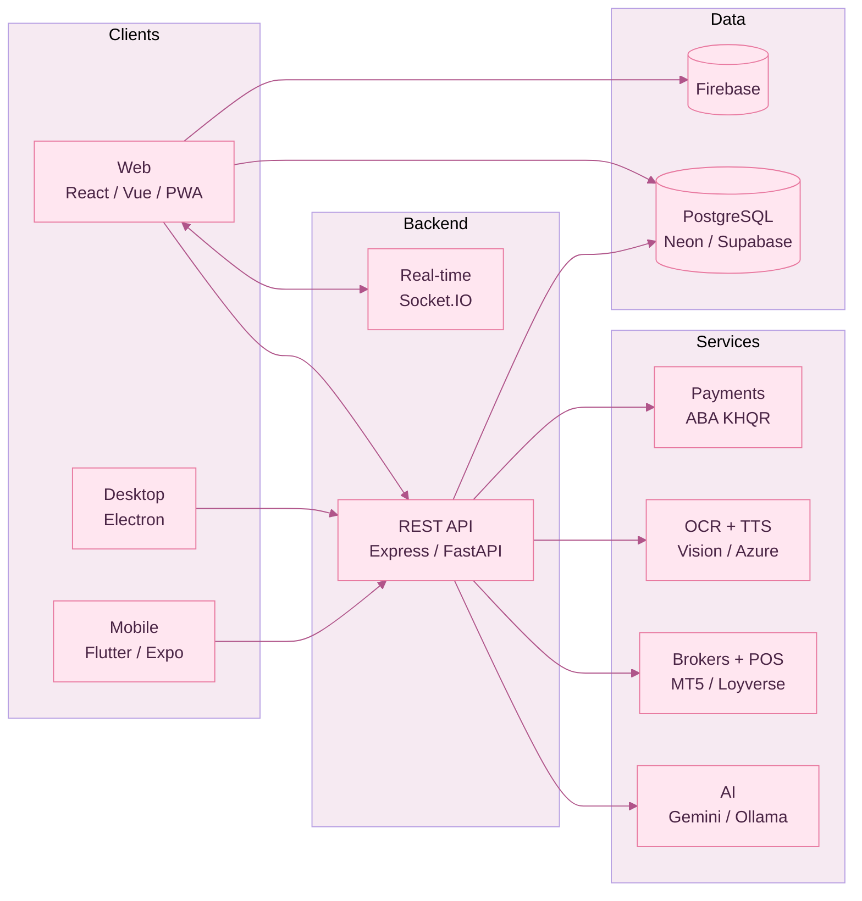

### Software engineering student building full-stack web and mobile products with React, Node.js and Flutter.

Based in Phnom Penh, Cambodia 🌸

 

<table align="center">
  <tr>
    <td align="center" width="33%">🥈 <b>First Runner-Up</b> E-Gen Innovation Program, MoEYS (2025)</td>
    <td align="center" width="33%">🏅 <b>Top 5 Finalist</b> SEA Sponge City Innovation Challenge (2025)</td>
    <td align="center" width="33%">🛰️ <b>NASA Space Apps Challenge</b> ORBY, a space-exploration game with real NASA data</td>
  </tr>
</table>

---

## ✨ About

I am a second-year Software Engineering student at CamTech. I build practical software: reliable backend services, clear interfaces, and products that work for the people who use them. I work well in teams and I care about accessibility, especially for communities with limited internet access.

| | |
|---|---|
| 💬 **Languages** | Khmer (native), English (fluent) |
| 🌱 **Looking for** | Software engineering internships (full-stack and backend) |

## 🧭 How I Work in the Era of AI

AI helps me build faster, but good software still starts with people. This is the order I follow:

1. **Know the problem from the user.** I start with the people who will use the product.
2. **Plan the project with the SDLC.** I follow the Software Development Life Cycle and write every document the user's requirements call for.
3. **Design the whole system.** I plan the system design and the architecture of the full system.
4. **Design the UX/UI.** I shape the experience and the interface before the build.

### The six stages

| # | Stage | What I do | Key deliverables |
|---|---|---|---|
| 01 | **Problem Discovery** Empathize and frame | Identify real-world friction points, user frustrations and technical constraints before writing a single line of code. | User interviews, problem definition, scope mapping |
| 02 | **Research and Insights** Explore and analyze | Analyze existing solutions, survey target audiences and form data-backed architectural hypotheses. | Competitive auditing, user personas, feature matrix |
| 03 | **UX Architecture** Structure and flow | Map user journeys and information architecture, and set up scalable database schemas and API contracts. | Wireframing, user flowcharts, API contract specs |
| 04 | **UI Design and Prototyping** Design and iterate | Craft design systems in Figma with tokens, typography hierarchy, high contrast and interactive prototypes. | Design system tokens, Figma high-fidelity mockups, interactive prototypes |
| 05 | **Agile Engineering** Develop and test | Translate designs into clean TypeScript and React code with full modularity, state management and edge-case testing. | React / Next.js implementation, Node.js API integration, unit and end-to-end validation |
| 06 | **Ship and Iterate** Deploy and optimize | Deploy to cloud platforms, evaluate Core Web Vitals and keep gathering user feedback for continuous improvement. | Production CI/CD, performance tuning, post-launch analytics |

### System architecture

The architecture I plan before development starts: clients, backend, data and external services.

---

## 🎀 Tech Stack

**Languages**

**Web and backend**

**AI and computer vision**

**Mobile**

**Databases and platforms**

**Tools and practices**

---

## 💻 Engineering Projects

### 🚀 ORBY: Lunar Astronaut Training Game
**An interactive space-exploration game built for the NASA Space Apps Challenge.**

- **What it does:** Players lead a crew of four astronauts at the Lunar South Pole for 90 days (Project Artemis) and can explore planets and moons using real NASA data. The app includes missions, a leaderboard and crew screens.
- **Stack:** `TypeScript`
- **Links:** [Live demo](https://orby-project.vercel.app/) · [Source code](https://github.com/SothSokhomal/ORBY-Project)

<!-- TODO: add one line on your role in ORBY, the rest of the stack, and the Space Apps result if there is one -->

### 🌐 Personal Portfolio Website with Admin Portal
**A full-stack portfolio that gives recruiters one place to see my skills, projects and experience.**

- **What it does:** Presents each project as a case study (problem, solution and architecture), along with my skills, experience and a downloadable résumé. A contact form lets recruiters reach me directly.
- **Admin portal:** A separate admin portal for managing the site.
- **Telegram bot:** A Telegram bot connected to the site.
- **Stack:** `React` `Node.js` `Express.js` `Telegram Bot`
- **Links:** [Live site](https://www.sothsokhomal.com/)

<!-- TODO: say what the admin portal manages and what the Telegram bot does, and add the source code link if the repo is public -->

### 🌦️ AI-Powered Weather Chatbot
**A chatbot that answers real-time weather questions for any location.**

- **What I built:** An NLP chatbot with intent recognition, so it understands varied ways of asking, plus a React interface.
- **Integration:** OpenWeatherMap API for fetching and parsing live weather data from the user's location query.
- **Stack:** `React.js` `Node.js` `NLP` `OpenWeatherMap API`
- **Links:** [Live demo](https://weather-ai-bot-632079387667.asia-southeast1.run.app/) · [Source code](https://github.com/SothSokhomal/Weather-Bot-App)

### 🧑‍💻 Face Recognition
**An end-to-end facial recognition pipeline.**

- **What I built:** A Python and OpenCV application that uses live webcam input to detect faces, draw bounding boxes and perform identity verification.
- **Stack:** `Python` `OpenCV`
- **Links:** [Source code](https://github.com/SothSokhomal/Face_Recognition)

### 📚 Jomnes App
**A mobile app that helps students and parents find part-time educators.**

- **My role:** Backend developer in a team with Flutter developers.
- **What I built:** Node.js and Express.js REST APIs for teacher discovery, with filtering by subject, level, location and availability.
- **Data model:** Structured tutor profiles covering subjects, pricing, schedule and contact details.
- **Collaboration:** Shared work with the Flutter developers through Git and GitHub.
- **Stack:** `Flutter` `Dart` `Node.js` `Express.js` `Supabase`

<!-- TODO: add the Jomnes live demo and GitHub repository links here once they are public -->

### 🏠 HomeSweet Rental App
**A cross-platform student housing app.**

- **My role:** Lead designer and system architect. I led the design team and coordinated requirements with developers.
- **What I built:** System architecture diagrams, flowcharts and data flows, plus technical specifications and design documentation.
- **Stack:** `Flutter` `Vue.js` `Firebase`
- **Links:** [Live demo](https://www.homesweet.site/)

---

## 🌍 Innovation and Impact

Projects focused on climate resilience and inclusive technology in Cambodia.

### 🌫️ ClearAir: Emergency Air Pollution Alert App
- **My role:** UX researcher and product designer.
- **What I built:** A prototype with Khmer and English AQI alerts, health guidance, and an SMS fallback for areas with low internet access.
- **How I validated it:** User interviews and usability testing with Cambodian users.
- **Who it is for:** Students, commuters and vulnerable communities exposed to air pollution.

### 🌧️ Green Flow: SEA Sponge City Innovation Challenge (2025) · 🏅 Top 5 Finalist
- **My role:** Researcher and technical contributor.
- **What I did:** Proposed nature-based flood solutions for Phnom Penh (rain gardens, bioswales and permeable pathways) and developed the prototype app.

### 🦻 SDablir: E-Gen Innovation Program, MoEYS (2025) · 🥈 First Runner-Up, Top 5 Team
- **My role:** Business analyst and researcher. I represented CamTech in a national competition.
- **What we built:** An IoT assistive tool for students with disabilities, including hard-of-hearing learners. The team was invited to demo the prototype.

---

## 🌱 Earlier Builds

| Project | What it is | Stack |
|---|---|---|
| [Personal Portfolio v1](https://github.com/SothSokhomal/SothSokhomal_portfolio) | Responsive portfolio site with modern UI components | `HTML` `CSS` `JavaScript` |
| [Expense Tracker](https://github.com/SothSokhomal/expenseapp) | CRUD web app to add, update and delete daily expenses | `HTML` `CSS` `JavaScript` |
| [Spotify UI Clone](https://github.com/SothSokhomal/song_soundie) | Responsive front-end clone for layout and CSS practice | `HTML` `CSS` `JavaScript` |

---

## 🐍 GitHub Contribution

<picture>
  <source media="(prefers-color-scheme: dark)" srcset="https://raw.githubusercontent.com/SothSokhomal/SothSokhomal/output/github-contribution-grid-snake-dark.svg">
  <source media="(prefers-color-scheme: light)" srcset="https://raw.githubusercontent.com/SothSokhomal/SothSokhomal/output/github-contribution-grid-snake.svg">
  
</picture>

---

## 📜 Certifications

- Scrum Master Certification, Agile Enterprise Coach (2026)
- ASEAN Data Science Explorers, ASEAN Foundation (2026)
- UX/UI Design Short Course, Future.Bit Academy (2025)
- Dynamic Web Development, Champion Coders (2024)

---

### 💌 Let's connect

I am open to software engineering internships and to collaborating on projects that make technology more accessible.

[Portfolio](https://www.sothsokhomal.com/) · [LinkedIn](https://www.linkedin.com/in/sothvannakrothchansokhomal/) · [Email](mailto:soth.vannakrothchansokhomal@gmail.com)

*Practical software, built with care.* 🌸

